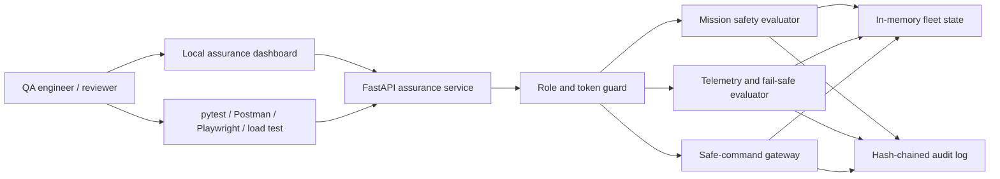
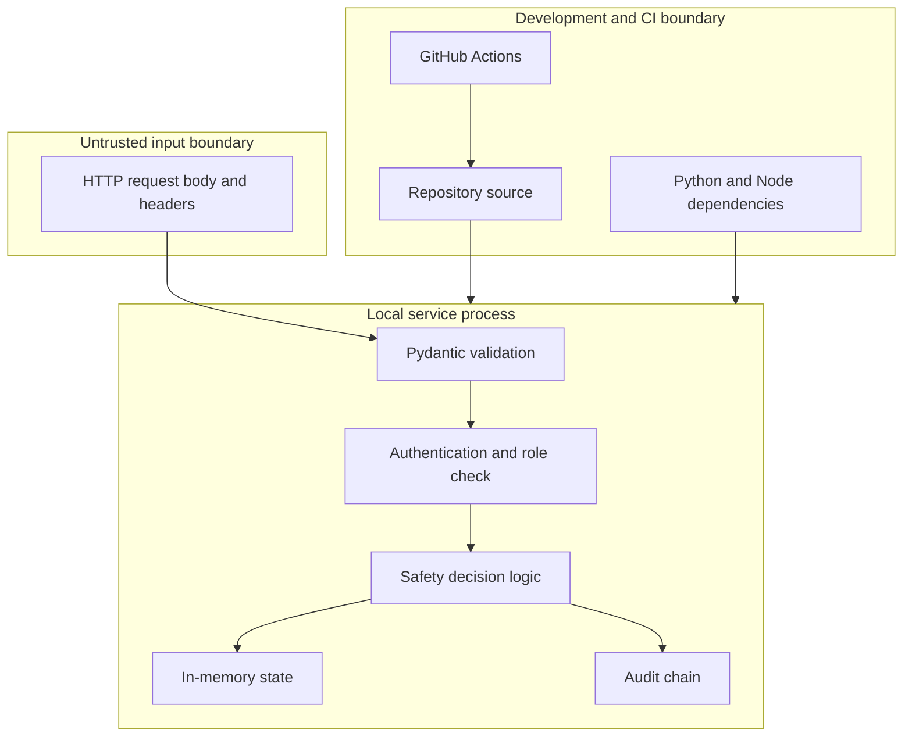

# Architecture

## Purpose

Sentinel UAS Assurance Lab is a local, simulation-only service for exercising QA and cyber-resilience techniques around high-consequence unmanned aircraft software. It evaluates synthetic mission plans, ingests synthetic telemetry, accepts a deliberately narrow set of safety commands, and records assurance evidence.

The system never connects to an aircraft, radio, autopilot, payload, navigation service, or operational network.

## System context

## Components

| Component | Responsibility | Important boundary |
| --- | --- | --- |
| FastAPI application | HTTP interface, OpenAPI contract, status codes, response models | Local synthetic API only |
| Authentication dependency | Maps an `X-Lab-Token` to one of four lab roles | Static lab tokens; not production identity |
| Mission evaluator | Applies launch, route, altitude, reserve, and maintenance gates | Does not calculate real aerodynamics or certification approval |
| Telemetry evaluator | Checks freshness, sequence order, ranges, and deterministic fail-safe priority | Synthetic Cartesian coordinates and simplified thresholds |
| Safe-command gateway | Accepts only `hold`, `return_home`, or `land` with freshness and replay controls | No flight-controller protocol or command transmission |
| Lab state | Stores three seeded aircraft, counters, and claimed command IDs | In memory; resets on restart |
| Audit log | Appends SHA-256-linked events and verifies the chain | Tamper-evident within the process, not tamper-proof storage |
| Dashboard | Reads fleet and assurance metrics for a quick demonstration | Not a ground-control station |
| QA assets | Requirements, cases, traceability, risks, FMEA, charters, and reports | Learning and portfolio evidence, not certification records |

## Trust boundaries

The API treats every header, timestamp, identifier, coordinate, percentage, sequence number, and free-text reason as untrusted. Pydantic applies type and range validation before domain logic. Authentication happens before protected operations. Authorization is endpoint-specific rather than inferred from the client UI.

## Role matrix

| Operation | Observer | Operator | Auditor | Maintainer |
| --- | :---: | :---: | :---: | :---: |
| Read health | Yes | Yes | Yes | Yes |
| Read fleet and metrics | Yes | Yes | Yes | Yes |
| Validate mission | No | Yes | No | Yes |
| Submit telemetry | No | Yes | No | Yes |
| Submit safe command | No | Yes | No | Yes |
| Read audit events | No | No | Yes | Yes |
| Reset simulation | No | No | No | Yes |

## Safety-decision order

Multiple abnormal conditions can exist in one telemetry frame. The evaluator uses a fixed priority so the result is repeatable:

1. Critical battery: `land`.
2. Outside operating geofence: `return_home`.
3. Inside restricted zone: `return_home`.
4. Above the configured altitude ceiling: `return_home`.
5. Critically degraded link: `return_home`.
6. Low sensor confidence: `hold`.
7. Otherwise: no fail-safe action.

This order is an explicit lab decision, not a recommendation for a real aircraft. Real behavior requires a system hazard analysis, platform knowledge, operational approval, and validation with representative hardware.

## Data flow

### Mission validation

1. The caller presents an operator or maintainer token.
2. Request fields are checked against the API schema.
3. The service finds the seeded aircraft and checks maintenance state.
4. Launch battery and link quality are checked.
5. Every waypoint is checked against the configured altitude ceiling, geofence, and restricted zone.
6. A deliberately simple battery estimate is compared with the requested recovery reserve.
7. The decision and reason are written to the audit chain.

### Telemetry ingestion

1. Authentication and schema checks run.
2. The aircraft ID must exist.
3. The timestamp must be recent and not excessively in the future.
4. The sequence must be greater than the last accepted sequence for that aircraft.
5. Geofence, restricted-zone, altitude, energy, link, and confidence conditions are evaluated in the documented order.
6. The synthetic fleet state and audit chain are updated.

### Safe command submission

1. Only a schema-defined safety action can be represented.
2. The command timestamp and TTL are checked.
3. A command ID can be claimed once per process lifetime.
4. The simulated mode changes and an audit event is appended.

## Availability and concurrency

State mutations and audit operations use process-local locks. This is enough for the single-process lab and its tests, but it is not a distributed consistency design. Running multiple workers would create independent fleet states and command-ID stores. A production-style evolution would require shared durable storage, idempotency guarantees, clock-source governance, signed evidence, and explicit recovery objectives.

## Deliberate limitations

- No physical model, navigation stack, collision avoidance, weather feed, map, radio, or GNSS simulation.
- No cryptographic signing of telemetry or commands.
- No rate limiter or external identity provider.
- No persistent or remote evidence store.
- No multi-tenant authorization model.
- No claim of airworthiness, operational authorization, security certification, or legal compliance.

These limitations are tracked rather than hidden. See `qa/risk-register.csv`, `qa/fmea.csv`, and `docs/lab-guide.md`.
