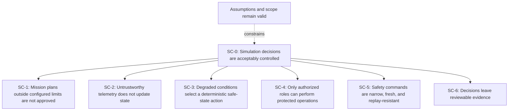

# Safety Case

## Claim

**SC-0:** Within its documented simulation boundary, the service makes deterministic mission, telemetry, and safe-command decisions that conform to the stated software safety requirements and exposes evidence sufficient for review.

This is an assurance argument for a portfolio lab. It is not an airworthiness safety case, operational approval, or claim that the logic is suitable for a real aircraft.

## Argument structure

## Claims and evidence

| Claim | Argument | Evidence |
| --- | --- | --- |
| SC-1 Mission envelope | Altitude, geofence, restricted-zone, maintenance, launch battery, link, and reserve gates are explicit and deny approval when violated | `tests/unit/test_safety.py`, `tests/api/test_missions.py`, `qa/requirements.csv`, boundary test cases |
| SC-2 Telemetry trust | Schema, known-aircraft, timezone, age, future-skew, and monotonic-sequence checks precede state update | `tests/api/test_telemetry.py`, `tests/security/test_input_hardening.py` |
| SC-3 Deterministic recovery | A documented priority resolves altitude, position, energy, link, and confidence hazards to one repeatable action | `tests/resilience/test_failsafe_behaviour.py`, decision order in `docs/architecture.md` |
| SC-4 Authorization | Protected operations have explicit server-side role dependencies and negative matrix tests | `tests/security/test_authorization.py`, OpenAPI security scheme |
| SC-5 Command constraint | The model can represent only three safety actions; timestamps, TTL, and command IDs are checked | `tests/api/test_commands.py`, `tests/contract/test_openapi.py` |
| SC-6 Evidence | Decisions append role, object, result, reason, timestamp, previous hash, and current hash; chain verification is tested | `tests/unit/test_audit.py`, `tests/api/test_commands.py`, assurance metrics |

## Safety requirements

The requirements tagged `SAF-*`, `RES-*`, and relevant `SEC-*` entries in `qa/requirements.csv` form the lab safety baseline. Their implementation links are maintained in `qa/traceability.csv`.

Key constraints include:

- operating geofence: inclusive square from -500 m to 500 m on both axes;
- restricted zone: inclusive rectangle from x 100-180 m and y -50-50 m;
- altitude ceiling: 120 m;
- launch battery minimum: 30%;
- critical battery threshold: 12%;
- launch link minimum: 55%;
- degraded-link threshold: below 30%;
- telemetry maximum age: 30 seconds;
- allowed future clock skew: 5 seconds;
- maximum command TTL: 30 seconds.

These values are fixtures for test design, not operational recommendations.

## Assumptions

- The process clock is sufficiently stable for a local lab.
- Each test runs against a known initial state.
- Request validation is not bypassed by direct internal mutation.
- One process owns the in-memory state.
- The default configuration matches the tested baseline unless tests explicitly override it.
- Test data remains synthetic and does not imply a real mission.
- Reviewers understand that a hash chain detects changes but does not make local memory immutable.

## Confidence-building activities

- Requirement review and acceptance criteria.
- Boundary-value, decision-table, state-transition, negative, and property-based tests.
- Branch-aware code coverage gate.
- Traceability validation and repository data checks.
- Threat model, risk register, and FMEA review.
- Static analysis, type checking, dependency audit, and CodeQL.
- Browser and API smoke checks in independent CI jobs.
- Honest documentation of open and accepted residual risk.

## Known gaps

The largest gap is external validity: the battery model, coordinates, link quality, confidence score, and recovery actions are abstractions. No conclusion about real flight behavior can be drawn from passing this suite. Other gaps include static bearer tokens, no cryptographic message origin, no durable evidence, no trusted time source, no rate limiter, and no representative hardware or network-in-the-loop tests.

These gaps are recorded in the risk register rather than treated as hidden assumptions.

## Release decision template

A portfolio release can be accepted when:

- the full automated suite and repository validators pass;
- all P1 requirements are covered;
- the audit-chain test passes;
- no open S1/S2 defect remains;
- changes to safety configuration receive independent review;
- current residual risks remain acceptable for a simulation-only learning project;
- documentation still clearly excludes operational use.
